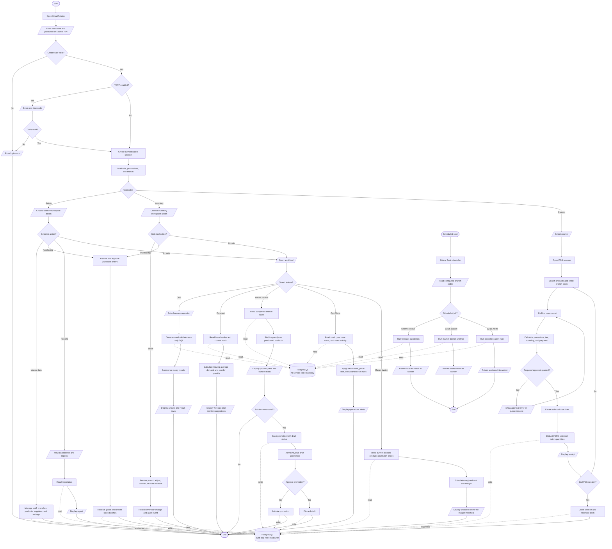
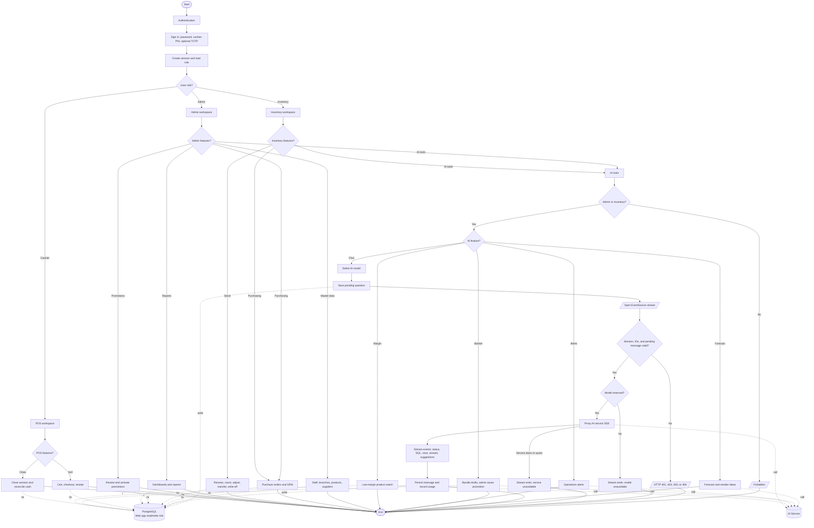

# SmartRetailAI Project Flowchart

This document uses UML-aligned activity/flowchart symbols (ISO-style) to show the main user, API, and scheduled-job paths as implemented in the current source tree:

- Rounded terminals: Start and End
- Parallelograms: user input or displayed output (I/O)
- Diamonds: decisions
- Rectangles: processes
- Cylinders: database roles (web app read/write, AI service read-only)
- Solid arrows: control-flow sequence
- Dotted arrows: a step reads or writes data; they do not add a process step

Executable diagrams: [`webapp.drawio`](./webapp.drawio) and [`aiservice.drawio`](./aiservice.drawio).



## Main components

- **Web app (Next.js):** edge auth gate (`proxy.ts`), session cookies + JWT, role/permission checks, branch-scoped workflows, POS, reports, and AI tool pages that relay to the Python AI service with `x-ai-service-token`.
- **Operational database:** shared source of truth for users, sales, purchasing, batch inventory, chat history, promotions, and financial records; accessed through the web app read/write role.
- **AI database access:** the same PostgreSQL database, accessed through a separate read-only role (`smartretail_ai_reader*`) with `SET TRANSACTION READ ONLY` and a 5s statement timeout.
- **Background jobs:** Celery Beat (timezone `Asia/Yangon`) schedules `forecast_build`, `basket_build`, and `ops_alerts` for configured branch codes. Interactive AI pages call the same job types on demand via `POST /jobs/enqueue`; chat uses SSE `GET /stream/rag`.

## AI Service Flowchart

Feature-level view of the Python AI service. Auth is service-token only (web app is trusted); no end-user login. Chat follows a three-tier cost ladder — cache hit (0 LLM calls before narration), one intent call that may select a pre-written SQL tool, or full schema + SQL generation — and streams SSE statuses as each step runs (`checking_intent` → `loading_schema` → `cache_hit` / `tool_matched` / `calling_model` → `validating_sql` → `executing` → `narrating` → `done`).

```mermaid
flowchart TD
    AIStart([Start]) --> Gate{Service token valid?}
    Gate -- No --> AIError[/Return auth error/]
    AIError --> AIEnd([End])
    Gate -- Yes --> Entry{Entry point?}

    Entry -- Chat SSE --> Normalize[Normalize question]
    Normalize --> LoadSchema[Load live schema]
    LoadSchema -. read .-> AIReadDB
    LoadSchema --> CacheKey["Build cache key: branch + schema + Yangon date + question"]
    CacheKey --> CacheHit{SQL cache hit?}
    CacheHit -- No --> Intent["Intent check and tool select (LLM call 1)"]
    CacheHit -- Yes --> HitGuard[Re-validate cached SQL with SQLGuard]
    Intent --> WriteCheck{Intent?}
    HitGuard -- Rejected --> Intent
    HitGuard -- Valid --> Execute[Execute read-only SQL]
    WriteCheck -- write --> Refuse[/Read-only refusal reply/]
    Refuse --> ChatOut[/Stream answer, sql_source, usage/]
    WriteCheck -- read --> ToolCheck{Tool matched?}
    ToolCheck -- No --> Generate["Live schema + SQL generation (LLM call 2)"]
    ToolCheck -- Yes --> Render[Render tool SQL template]
    Render --> ToolGuard{SQLGuard passes?}
    ToolGuard -- No --> Generate
    ToolGuard -- Yes --> Store[Store SQL in cache]
    Generate --> GenGuard{SQLGuard passes?}
    GenGuard -- No --> Diagnose[Explain failure (LLM)]
    GenGuard -- Yes --> Store
    Store --> Execute
    Execute -. read .-> AIReadDB
    Execute --> ExecOK{Query ok?}
    ExecOK -- No --> Invalidate[Drop cached entry]
    Invalidate --> Diagnose
    ExecOK -- Yes --> Rows[Cap rows at 50]
    Rows --> Narrate[Narrate answer (LLM)]
    Narrate --> ChatOut
    Diagnose --> ChatOut
    ChatOut --> AIEnd

    Entry -- On-demand job --> Jobs[Analytics Jobs]
    Jobs --> JobType{Job type?}
    JobType -- Forecast --> Forecast[Forecast: demand and reorder]
    JobType -- Basket --> Basket[Market Basket: co-purchase rules]
    JobType -- Alerts --> Alerts[Ops Alerts: stock, price, abuse]
    JobType -- Margin --> Margin[Margin: thin-margin flags]
    Forecast --> Result[/Return JSON result/]
    Basket --> Result
    Alerts --> Result
    Margin --> Result
    Alerts -. read .-> AIReadDB
    Result --> AIEnd

    Entry -- Celery Beat --> Nightly[Nightly batch by branch]
    Nightly -- 02:00 forecast_build --> NightlyForecast[Build forecast inputs]
    Nightly -- 02:05 basket_build --> NightlyBasket[Build basket inputs]
    Nightly -- 02:15 ops_alerts --> Alerts
    NightlyForecast -. read .-> AIReadDB
    NightlyBasket -. read .-> AIReadDB
    NightlyForecast --> Result
    NightlyBasket --> Result

    AIReadDB[(PostgreSQL<br/>AI read-only role)]
```

## Next.js Web App Flowchart

Feature-level view of the Next.js web app. Session auth + role-based workspaces; every AI feature calls the Python AI service through server API routes with `x-ai-service-token` (POS checkout never touches AI). Chat uses a two-step contract: `POST /api/ai/conversations` (or `.../messages`) saves the pending question, then `GET /api/ai/sse?conversation_id&message_id&model_id` validates session, role, UUIDs, and the saved pending message (401 / 403 / 400 / 404 `CHAT_MESSAGE_UNAVAILABLE`), reserves the selected model (terminal done event `AI_MODEL_UNAVAILABLE`), proxies the upstream AI stream (service down → done event `AI_UNAVAILABLE`; upstream quota → `AI_QUOTA_EXCEEDED`), persists the finished message, and records token usage. Terminal failures always arrive as a single `done` event on an open 200 stream, so the page has one client path; a non-streaming `POST /api/ai/chat` relay for the `rag_answer` job exists as well.


