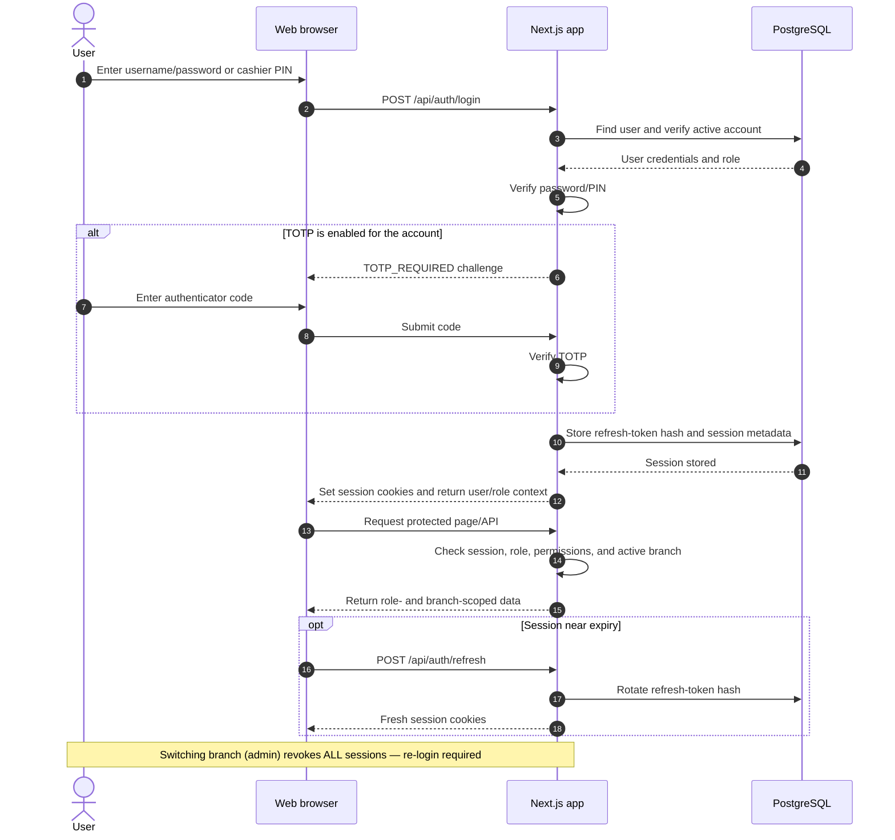
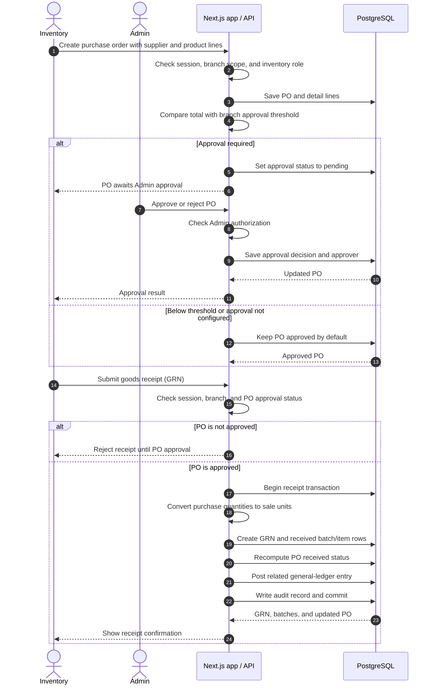
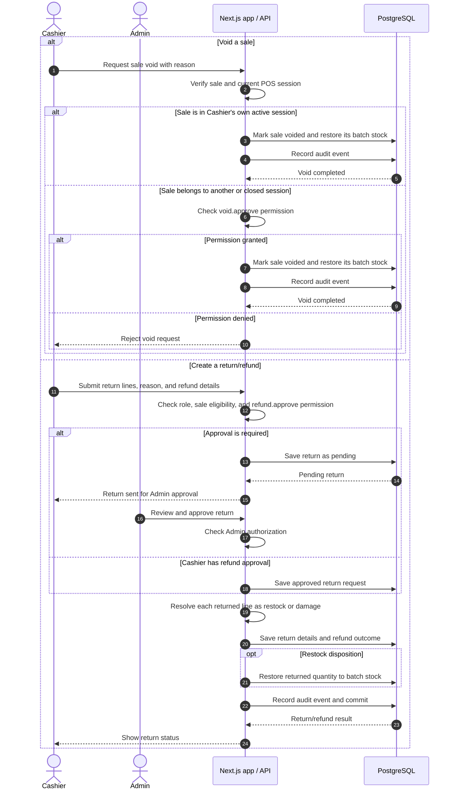
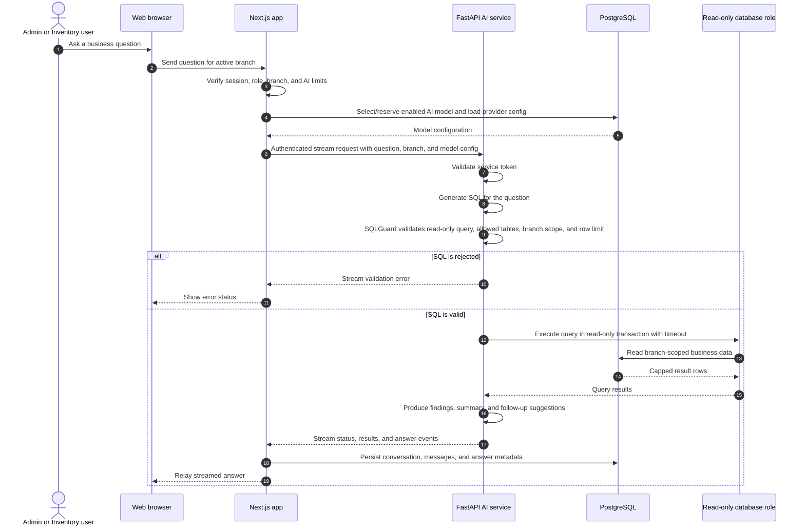

# SmartRetailAI Sequence Diagrams

UML sequence diagrams of the main request flows across the Next.js web app, PostgreSQL, and the Python AI service. Flows are **split by domain group** (same grouping as [`SCHEMA_DIAGRAMS.md`](./SCHEMA_DIAGRAMS.md)) and follow the role/permission rules in `web-app/docs/FEATURES_*.md`.

| #   | Group         | Diagram                                  |
| --- | ------------- | ---------------------------------------- |
| 1   | Auth & access | Sign in, TOTP, and session               |
| 2   | Purchasing    | Purchase order approval and GRN          |
| 3   | Purchasing    | Supplier payment and return confirmation |
| 4   | Stock         | Adjustment, ground-balance, transfer     |
| 5   | POS           | Session, checkout, offline sync, close   |
| 6   | POS           | Sale void and sale return approval       |
| 7   | Finance       | Expense with GL auto-posting             |
| 8   | Staff         | Roster planning and attendance           |
| 9   | Notifications | Alert scan → in-app + Telegram           |
| 10  | AI            | Chat with read-only business data        |
| 11  | AI            | Forecast job pipeline                    |

Executable diagrams: [`sequence.drawio`](./sequence.drawio) (one page per flow).

---

## Auth & access

### 1. Sign in and establish a session



---

## Purchasing

### 2. Create a purchase order and receive goods



### 3. Supplier payment and supplier return confirmation

```mermaid
sequenceDiagram
    autonumber
    actor Inventory
    actor Admin
    participant Web as Next.js app / API
    participant DB as PostgreSQL

    Inventory->>Web: Record supplier payment (amount, method)
    Web->>Web: Check session, branch, and inventory role
    Web->>DB: Begin txn; insert supplier_payment
    Web->>DB: Recompute PO payment_status (unpaid/partial/paid)
    Web->>DB: Commit
    alt Amount exceeds unpaid balance
        Web-->>Inventory: Saved with OVERPAYMENT warning
    else Within balance
        Web-->>Inventory: Payment saved
    end
    Inventory->>Web: Create supplier return draft from GRN lines
    Web->>DB: Save return header and detail lines (status = draft)
    Inventory->>Web: Request confirmation
    Web->>Web: Check supplier_return.confirm permission
    alt Permission denied (inventory by default)
        Web-->>Inventory: Draft stays queued for Admin
        Admin->>Web: Confirm return
        Web->>Web: Admin passes hasPermission() unconditionally
    else Permission granted
        Web->>Web: Proceed to confirmation
    end
    Web->>DB: Begin confirmation txn; decrement batch stock
    Web->>DB: Reduce linked PO total when unpaid/partial; recompute payment_status
    Web->>DB: Set status = confirmed; write audit; commit
    DB-->>Web: Confirmed return
    Web-->>Admin: Return confirmed
```

---

## Stock

### 4. Inventory adjustment, stock-take, and transfer

```mermaid
sequenceDiagram
    autonumber
    actor Inventory
    actor Approver as Inventory approver / Admin
    participant Web as Next.js app / API
    participant DB as PostgreSQL

    alt Post stock adjustment or expiry write-off
        Inventory->>Web: Submit batch, quantity delta, and reason
        Web->>Web: Check role, branch, and adjustment input
        Web->>DB: Begin transaction and read current batch balance
        Web->>DB: Save adjustment and before/after quantities
        Web->>DB: Update batch stock and post GL entry
        Web->>DB: Record audit event and commit
        DB-->>Web: Updated balance
        Web-->>Inventory: Show posted adjustment
    else Record ground-balance count
        Inventory->>Web: Submit physical count by batch
        Web->>DB: Read live system quantity for each batch
        Web->>Web: Calculate difference from physical count
        Web->>DB: Save count header and detail lines
        Note over Web,DB: Ground Balance is count-only; it does not change stock
        DB-->>Web: Saved count
        Web-->>Inventory: Show count and differences
    else Transfer stock between branches
        Inventory->>Web: Create transfer with batches and quantities
        Web->>Web: Check source/destination branches and transfer.approve
        alt Approval is required
            Web->>DB: Save transfer as pending
            Web-->>Approver: Transfer awaits approval
            Approver->>Web: Approve transfer
            Web->>DB: Save approval status and approver
        else Inventory permission allows approval (default)
            Web->>DB: Save transfer as approved
        end
        Web-->>Inventory: Transfer ready for dispatch
        Inventory->>Web: Receive transfer at destination
        Web->>DB: Update transfer state and move batch quantities
        Web->>DB: Post related GL entry, audit, and commit
        DB-->>Web: Transfer received
        Web-->>Inventory: Show received transfer
    end
```

---

## POS

### 5. POS session, checkout, offline sync, and close

```mermaid
sequenceDiagram
    autonumber
    actor Cashier
    participant Browser as POS terminal
    participant Web as Next.js app / API
    participant DB as PostgreSQL

    Cashier->>Browser: Select counter and enter opening cash
    Browser->>Web: Open POS session
    Web->>Web: Check role, branch, and active-session constraints
    Web->>DB: Create or select active session
    DB-->>Web: Session context
    Web-->>Browser: Open terminal
    Cashier->>Browser: Search product / scan barcode
    Browser->>Web: Search branch inventory
    Web->>DB: Read available batches and product data
    DB-->>Web: Product and stock results
    Web-->>Browser: Show available product and price
    Cashier->>Browser: Add products, park or resume cart
    Browser->>Web: Persist cart changes
    Web->>DB: Save cart and cart lines
    Cashier->>Browser: Checkout with payment tender
    Browser->>Web: POST /api/pos/checkout
    Web->>Web: Check session, branch, and permission gates
    opt Manual discount requested
        Web->>Web: Check discount.approve permission
    end
    Web->>DB: Begin checkout transaction and lock/select eligible batches
    Web->>Web: Apply promotions, line tax, discounts, and Kyat rounding
    Web->>DB: Create sale and sale-detail rows
    Web->>DB: Deduct quantities from FEFO-selected batches
    Web->>DB: Record audit event and commit
    DB-->>Web: Completed sale
    Web-->>Browser: Receipt data and QR receipt link
    Browser-->>Cashier: Display receipt
    opt Network unavailable
        Browser->>Browser: Queue checkout locally (idempotent key)
        Browser->>Web: POST /api/pos/checkout/sync when online
        Web->>Web: Replay guard — already-queued sales are not double-applied
        Web-->>Browser: Sync result per queued sale
    end
    Cashier->>Browser: Close session with actual till count
    Browser->>Web: Close POS session
    Web->>DB: Compute expected cash and difference; save close values
    DB-->>Web: Session report and cash difference
    Web-->>Browser: Show reconciliation result
```

### 6. Sale return or sale void



---

## Finance

### 7. Expense with GL auto-posting

```mermaid
sequenceDiagram
    autonumber
    actor Admin
    participant Web as Next.js app / API
    participant DB as PostgreSQL

    Admin->>Web: Create expense (category, amount, date, method, optional float)
    Web->>Web: Check admin role and branch scope
    Web->>DB: Validate category exists; float open when provided
    Web->>DB: Begin transaction; insert expense row
    Web->>DB: postJournal — Dr 5100 Operating Expenses / Cr 1000 cash or 1010 bank
    Web->>DB: Commit transaction
    Web->>DB: Read expense_budget for category + month
    alt Month total exceeds budget
        Web-->>Admin: Saved with OVER_BUDGET warning (non-blocking)
    else Within budget
        Web-->>Admin: Expense saved
    end
    Web->>DB: Write audit record
    Note over Web,DB: Manual journals follow the same postJournal path but must balance (debits = credits) or are rejected
```

---

## Staff & notifications

### 8. Roster planning and attendance

```mermaid
sequenceDiagram
    autonumber
    actor Admin
    actor Staff as Inventory staff
    participant Web as Next.js app / API
    participant DB as PostgreSQL

    Admin->>Web: Create shift roster / roster schedule (user, date, planned times)
    Web->>Web: Check admin role
    Web->>DB: Validate HH:MM times; expand schedule into roster entries
    DB-->>Web: Saved roster rows
    Web-->>Admin: Roster visible under /staff and /admin/shift-rosters
    Staff->>Web: Clock in (POST /api/inventory/attendance)
    Web->>Web: Check inventory role
    alt Already clocked in
        Web-->>Staff:409 ATTENDANCE_ALREADY_ACTIVE
    else No active record
        Web->>DB: Insert staff_attendance with clock_in_at
        Web->>DB: Write audit record
        Web-->>Staff: Attendance started
    end
    Staff->>Web: Clock out
    Web->>DB: Set clock_out_at; write audit record
    Web-->>Staff: Attendance closed
    Note over Admin,DB: Admin reviews attendance via /reports/attendance
```

### 9. Alert scan and notification delivery

```mermaid
sequenceDiagram
    autonumber
    participant Cron as Scheduler (CRON_SECRET)
    participant Web as Next.js (runAlertScan)
    participant DB as PostgreSQL
    participant TG as Telegram Bot API
    actor User

    Cron->>Web: GET /api/cron/alerts with Bearer CRON_SECRET
    Web->>Web: Validate cron secret
    Web->>DB: Load branches, batch stock, and expiry dates
    Web->>DB: Compute low-stock and expiry breaches per branch
    Web->>DB: Insert notifications (deduped per branch/type)
    opt Telegram alerts enabled
        Web->>TG: notifyTelegram(low-stock / expiry summary)
        TG-->>Web: Message sent
    end
    DB-->>Web: Scanned branch counts
    Web-->>Cron: { ok, branches, skipped }
    User->>Web: Open notification feed
    Web->>DB: List unread notifications for user/branch
    Web-->>User: Notifications; mark read on demand
```

---

## AI

### 10. AI chat with read-only business data



### 11. Forecast job pipeline

```mermaid
sequenceDiagram
    autonumber
    actor User as Admin or Inventory user
    participant Web as Next.js /api/ai/forecast
    participant AI as FastAPI AI service
    participant Q as Queue / worker or inline run

    User->>Web: Request forecast (days, window, lead time, safety)
    Web->>Web: Check session; role is admin or inventory
    Web->>AI: POST /jobs/enqueue (forecast_build, branch_id, model headers)
    alt Provider quota exceeded
        AI-->>Web:429
        Web-->>User: AI_QUOTA_EXCEEDED
    else Enqueued
        AI->>AI: Validate model credentials and spending limits
        alt Production (Redis Stream)
            AI->>Q: Push job to stream
            Q->>Q: Worker runs branch-scoped forecast build
            Q-->>AI: Job result available
        else Dev (simple path)
            AI->>AI: Run job synchronously
        end
        AI-->>Web: { ok, job_id, forecasts, insights }
        Web-->>User: Forecasts and reorder suggestions (max 200 rows)
        opt Live updates
            AI-->>Web: SSE events via GET /api/ai/sse
            Web-->>User: Streamed job status
        end
    end
```
