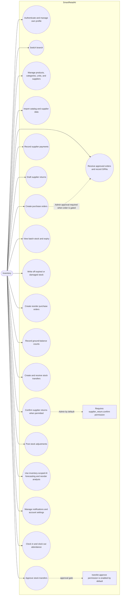
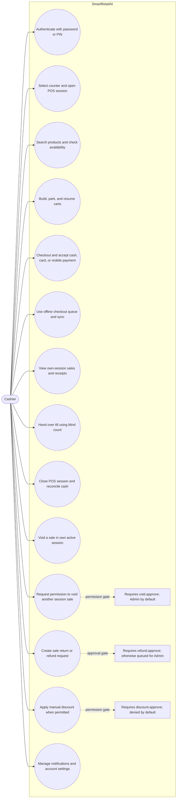

# SmartRetailAI Use Case Diagrams

UML use case diagrams of the capabilities available to each application role. Use cases sit inside the SmartRetailAI system boundary; permission-gated actions are annotated where approval depends on the configured role permissions (`discount.approve`, `refund.approve`, `transfer.approve`, `void.approve`, `supplier_return.confirm`). Based on `web-app/docs/FEATURES_ADMIN.md`, `FEATURES_INVENTORY.md`, and `FEATURES_CASHER.md`.

Executable diagrams: [`usecase.drawio`](./usecase.drawio) (one page per role).

## Admin

```mermaid
flowchart LR
    Admin([Admin])
    subgraph System[SmartRetailAI]
        A1((Authenticate and manage own profile))
        A2((Switch branch))
        A3((Manage staff, branches, counters, and permissions))
        A4((Manage catalog, suppliers, customers, and imports))
        A5((Create and approve or reject purchase orders))
        A6((Receive goods and manage GRNs))
        A7((Manage stock, transfers, counts, adjustments, and expiry))
        A8((Manage promotions))
        A9((Manage expenses, budgets, and petty cash))
        A10((Manage chart of accounts and journal entries))
        A11((Operate or supervise POS sessions))
        A12((Void sales and approve sale returns or refunds))
        A13((Review reports and audit logs))
        A14((Manage backups and scheduled jobs))
        A15((Use AI chat, forecasts, and analytics))
        A16((Configure AI models and provider keys))
        A17((Manage notifications, Telegram alerts, and settings))
        A18((Manage shift rosters and attendance reports))
    end
    Admin --> A1
    Admin --> A2
    Admin --> A3
    Admin --> A4
    Admin --> A5
    Admin --> A6
    Admin --> A7
    Admin --> A8
    Admin --> A9
    Admin --> A10
    Admin --> A11
    Admin --> A12
    Admin --> A13
    Admin --> A14
    Admin --> A15
    Admin --> A16
    Admin --> A17
    Admin --> A18
```

## Inventory

## Cashier

### Role and permission notes

- Inventory can create purchase orders but cannot approve or reject them. GRN receiving is blocked until required purchase-order approval is complete.
- Inventory transfer approval is enabled by default through `transfer.approve`. Supplier-return confirmation requires `supplier_return.confirm`, which is Admin-only by default.
- Cashier can void sales in their own active session. Voids outside that session, manual discounts, and immediate sale-return approval are permission-gated; without refund approval, a return waits for Admin approval.
- Attendance clock-in/out (`/api/inventory/attendance`) is available to Inventory only; shift rosters and roster schedules are Admin-managed; Admin reviews the attendance report.
- Low-stock and expiry alerts are produced by the scheduled alert scan (`/api/cron/alerts`) and delivered in-app and to Telegram; each user manages their own notification preferences.
- AI access is available to Admin and Inventory with Inventory restricted to inventory-focused capabilities. POS checkout does not depend on the AI service.
